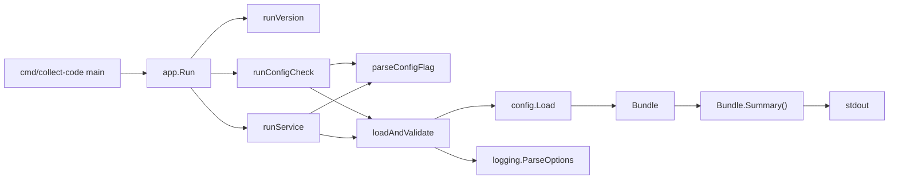
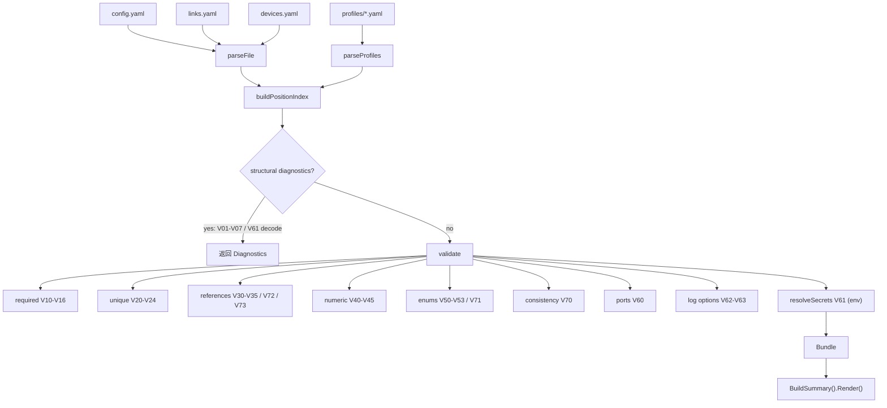
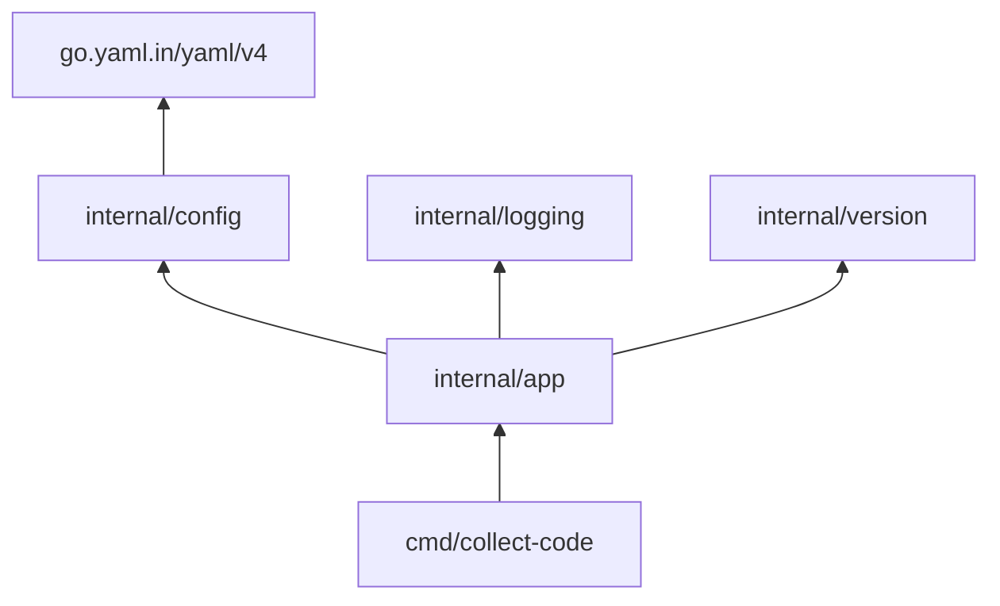
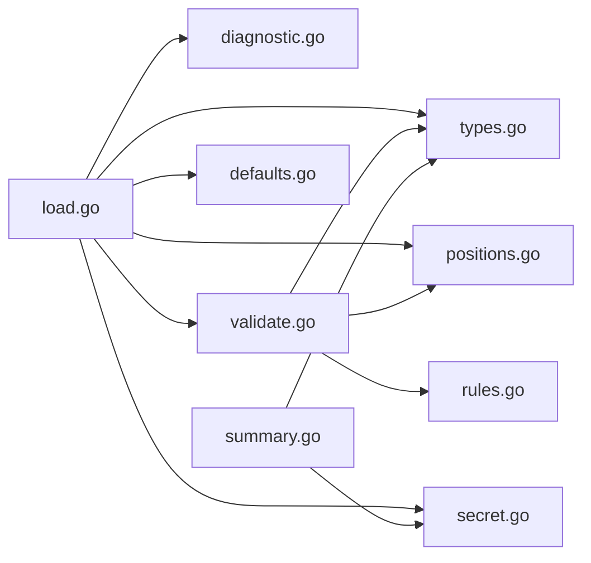
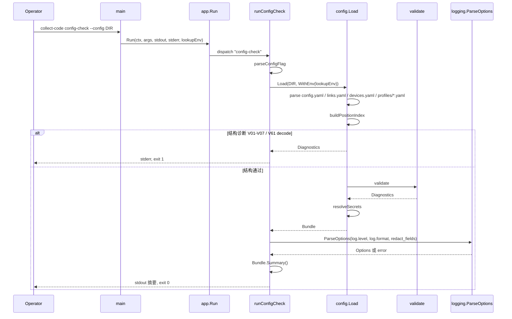
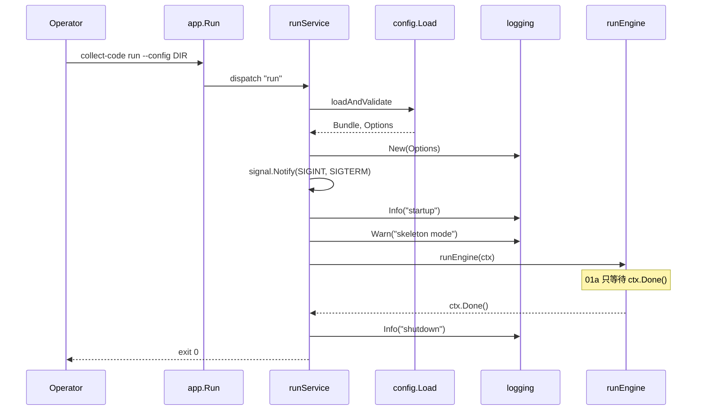

# 01 代码走读：配置基座（01a / 01b / 01c）

- 状态：完成
- 范围：完整 ticket 01，即 01a 骨架、01b 配置校验、01c 配置语义补强
- 代码路径：`cmd/collect-code`、`internal/app`、`internal/config`、`internal/logging`、`internal/version`
- 本文只描述已实现的代码，不描述后续 ticket（驱动、通道、适配器、Store、Clock）的运行时行为。

---

## 1. 链路

### 1.1 进程入口与命令分发

`cmd/collect-code/main.go` 只做一件事：把 `os.Args` 交给 `app.Run`，用返回码退出。
`app.Run` 是 CLI 的唯一分发点，命令、退出码和输出契约都收敛在这里。



- `version`：打印二进制版本、提交、构建时间、Go 版本与平台。
- `config-check`：加载 + 校验配置，成功后把生效摘要写到 stdout；失败把诊断写到 stderr。
- `run`：与 `config-check` 共用 `loadAndValidate`，然后初始化日志、安装信号处理，进入骨架 `runEngine`。

### 1.2 配置加载链路

`config.Load` 是唯一的加载入口，按固定顺序读取四层配置：

1. `config.yaml`：节点、北向 MQTT、时序、缓存、队列、状态库、日志、健康检查、适配器 Topic。
2. `links.yaml`：南向链路。
3. `devices.yaml`：设备实例。
4. `profiles/*.yaml`：设备模板（点位、服务、事件、payload 位域）。

每个文件先用 `yaml.Load` 解析为 `yaml.Node` 建立位置索引，再用
`yaml.Load(..., WithKnownFields(), WithUniqueKeys())` 严格解码。这样语义诊断
（例如 `devices[0].device_type` 不一致）能落到具体键的行列，而不是数组元素。



关键顺序：

- **结构优先**：出现语法错误、未知键、重复键、类型错、空文档、文件缺失等结构诊断时，
  不再做语义校验。解码结果已不可信，继续校验只会产生级联误报。
- **语义校验**：必填 → 唯一 → 引用/能力 → 数值 → 枚举 → 类型一致性 → 端口 → 日志选项。
- **凭据解析**：语义校验通过后才解析 `env:NAME`，因此环境变量缺失不会和结构错误混在一起。
- **摘要**：只有全部通过才构造 `Bundle` 并渲染生效摘要；摘要中的密码、Token、
  broker userinfo 都经过 `Secret` 脱敏。

### 1.3 诊断链路

所有配置问题统一表示为 `Diagnostic{File, Line, Col, RuleID, Message}`，最终格式为：

```text
file:line:col: Vxx: message
```

- `positions.go` 用 `nodePath` 记录“映射键/序列下标”的路径，`positionIndex.at` 返回键的行列。
- 跨文件引用错误定位在**引用字段**所在文件与行，例如 device 引用了不存在的 profile，
  报在 `devices.yaml` 的 `profile` 键；service 引用了不存在的 point，报在 profile 文件的
  `services[i].writes[j].point` 键。
- `finalizeDiagnostics` 负责按文件层序、行、列、规则号排序，并按
  `(File, Line, Col, RuleID, Message)` 去重。
- `Diagnostic`/`Diagnostics` 的 `Error` 使用指针接收者：只有指针实现 `error`，
  值类型保留 `String()` 供 `%v` 与测试输出使用。

---

## 2. 组件与对象关系

### 2.1 包依赖

当前只有 CLI、应用编排、配置、日志、版本五个包；驱动、通道、适配器尚未接入，
这是 01a 的刻意边界。



约束：

- `internal/config` 不感知 CLI、日志实现或具体协议。
- `internal/app` 是唯一把配置、日志、版本拼在一起的地方；后续具体驱动/通道的构造也应
  只发生在 `cmd` 或 `app` 的装配层。
- `internal/logging` 只依赖标准库；`internal/version` 只提供构建变量。

### 2.2 config 包内部对象



| 对象/文件 | 职责 |
|---|---|
| `Bundle` | 加载后的完整配置：`Config`、`Links`、`Devices`、`Profiles`、`ProfileSources` |
| `types.go` | 四层 YAML 的 DTO；指针字段用于区分“未配置”和显式零值 |
| `defaults.go` | `Default()` 返回每次全新的默认配置，避免切片共享 |
| `load.go` | 读取、严格解析、结构诊断、语义校验、凭据解析的唯一编排 |
| `positions.go` | YAML 节点位置索引与路径编码 |
| `diagnostic.go` | 诊断值、排序、去重、错误聚合 |
| `validate.go` | 语义规则实现；按 `required/unique/references/numeric/enums/consistency/ports/logOptions` 分组 |
| `rules.go` | V01–V73 规则号常量；规则号是输出契约的一部分 |
| `secret.go` | 密码/Token 的标量解析、`env:` 解析、脱敏 |
| `summary.go` | 稳定 DTO `EffectiveSummary` 与多行摘要渲染 |
| `internal/logging` | 日志级别/格式/脱敏字段的解析与 `slog` 构造 |

### 2.3 校验规则分组

| 分组 | 规则 | 说明 |
|---|---|---|
| 结构 | V01–V07 | 语法、空文档、未知键、重复键、类型、文件、profile 重名 |
| 必填 | V10–V16 | config/link/device/profile/point/service/event 的必填字段 |
| 唯一 | V20–V24 | link id、device sn、profile 内 point/service/event 标识 |
| 引用与能力 | V30–V35 | profile/link 引用、write 可写、verify 可读；P1=A 点位并集口径 |
| 数值 | V40–V45 | min/max、scale、poll、freshness、offline、qos |
| 枚举/传输 | V50–V53 | driver、传输块匹配、parity、access |
| 端口/凭据/日志 | V60–V63 | 端口冲突、凭据引用、日志级别与格式 |
| 语义补强 | V70–V73 | device/profile 类型一致、类型枚举、trigger 点位、`writes[].from` 参数引用 |

V70–V73 是 01c 新增的规则，均只读取已有字段，不改变摘要 DTO，也不引入运行时行为。

### 2.4 点位能力口径（P1=A）

`pointCaps` 把 profile 中三类点位声明合并为一张能力表：

- `points[].access = r`：可读；
- `points[].access = rw`：可读可写；
- `payload.decode[].key`：可读；
- `payload.encode[].key`：可写、不可读；
- 同一 key 多处出现时合并能力。

`checkPointUse` 在这一张表上统一实现“存在性 + 可读/可写”检查：

- `writeUse`：`writes[].point`，要求可写；
- `verifyUse`：`verify.point`，要求可读；
- `triggerUse`：`events[].trigger.point`，要求可读。

这样 V32–V35、V72 不需要各自维护一套点位并集，也不会出现“write 能写、verify 不能读”
的口径漂移。

---

## 3. 时序

### 3.1 `config-check`



### 3.2 `run` 骨架



01a 的 `run` 是骨架：没有驱动、通道、调度器，只验证配置能加载、日志能初始化、
信号能触发统一关闭路径。后续 ticket 在 `runEngine` 内接入调度与采集，但不改变
CLI/退出码/摘要契约。

---

## 4. 测试与门禁

- `internal/config/*_test.go`：默认值、严格解析、位置索引、诊断排序/去重、
  39+4 条规则、摘要脱敏、错误接口的指针接收者约束。
- `internal/app/golden_test.go`：
  - `TestGoldenCorpus`：`base/` 加 legal/invalid/ordering 覆盖层，逐字节比对 stdout/stderr；
  - `TestRuleCatalogCoverage`：每条规则必须有 legal 与 invalid 用例，且 invalid 的
    `want.stderr` 必须出现对应规则号；
  - `TestDiagnosticFormat`：所有诊断必须匹配 `file:line:col: Vxx: message`，行列非零。
- `internal/app/logging_agreement_test.go`：V62/V63 的合法枚举集合必须与
  `logging.ParseOptions` 接受集合一致，防止配置校验与日志实现漂移。
- `make ci`：`fmt-check`、`print-check`、`go fix -diff -mapsloop`、`go vet`、
  `go test`、双架构静态构建、`verify-static`、`config-check configs/example`、
  `test-race`、`golangci-lint`。

---

## 5. 后续缝隙

当前包边界为后续 ticket 预留了三条扩展点，但 01 尚未实现具体协议：

- `Driver`：南向协议；`modbus` 与 `lorawan` 在后续 ticket 接入。
- `Channel`：北向传输；当前只有 MQTT 配置 DTO，没有连接实现。
- `UplinkAdapter`/`DownlinkAdapter`：物模型翻译；当前只有 `adapter.topics` 配置。
- `Store`：持久化缝隙；01 只有 `state.db_path` 配置，bbolt 实现在 02b。
- `Clock`：时间缝隙；01 的配置校验不读取时间，运行时组件在 02a 之后接入。

这些缝隙的实现不得反向进入 `internal/config`；配置包只负责“把配置读对、校验对、
摘要打印对”。
