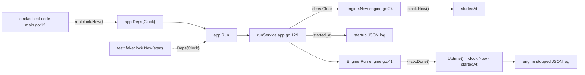
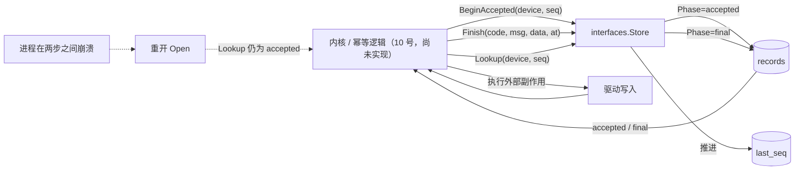
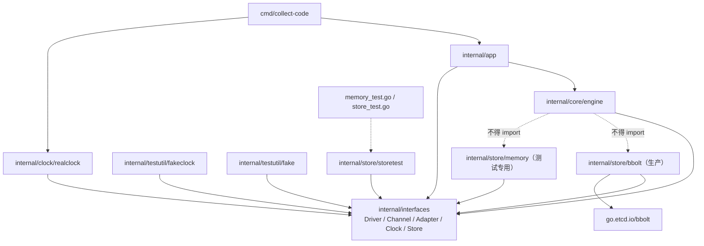
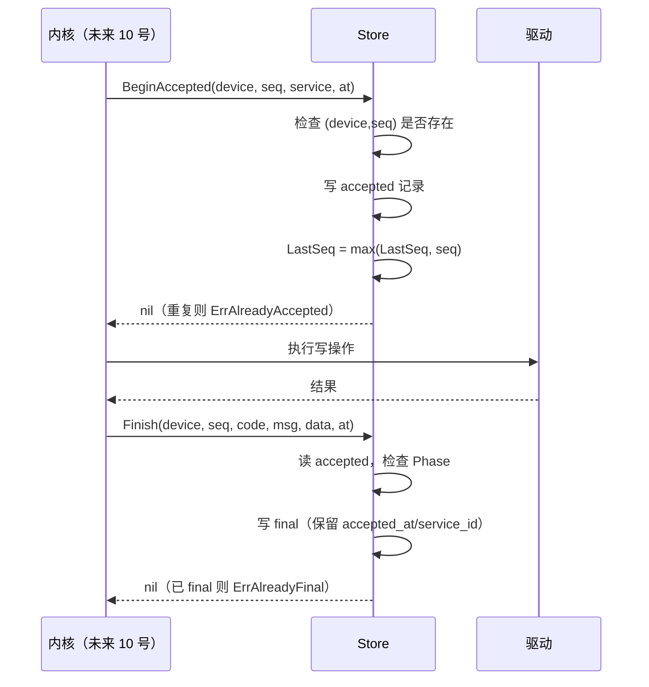
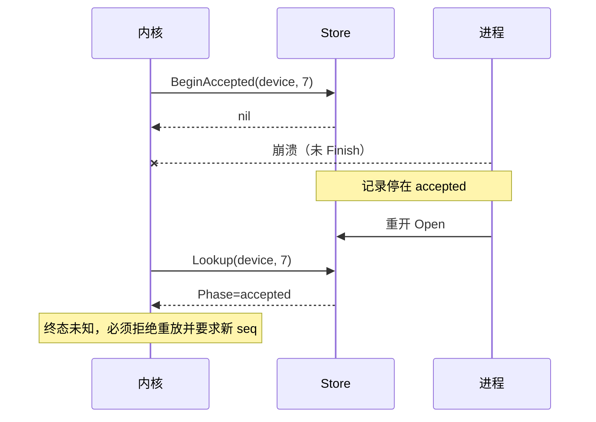
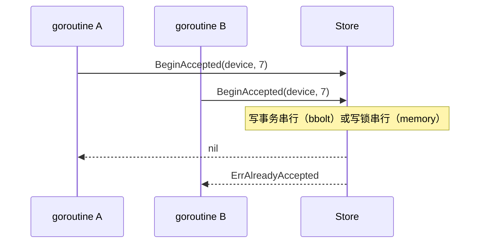
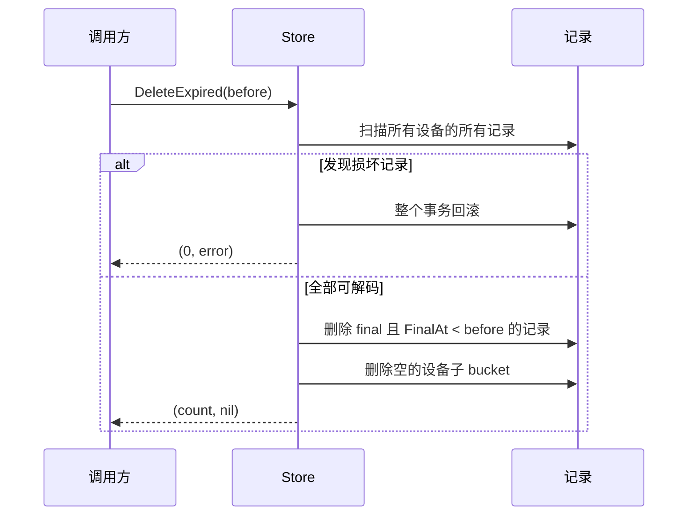
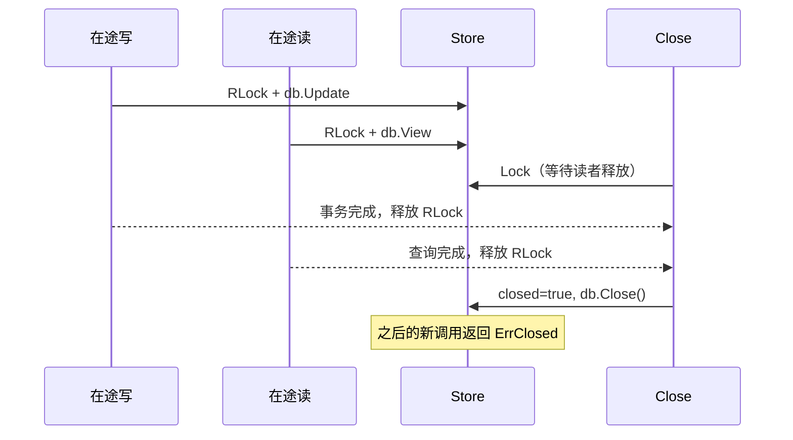

# 02 代码走读：接口与状态基座（02a / 02b）

- 状态：完成
- 范围：完整 ticket 02，即 02a 内核接口与假时钟、02b Store 契约与 bbolt 实现
- 代码路径：`internal/interfaces`、`internal/core/engine`、`internal/clock/realclock`、`internal/testutil/{fake,fakeclock}`、`internal/store/{storetest,memory,bbolt}`、`scripts/check-deps.sh`、`scripts/check-time.sh`
- 本文只描述已实现的代码。Scheduler（03a）、驱动、真实 MQTT 通道与适配器不在本文范围；`Store` 目前没有生产调用方，内核尚未持有它，只有测试通过共享契约套件使用。

---

## 1. 链路

### 1.1 时间接缝：唯一时间源经注入进入内核

`Clock` 是内核和驱动代码的唯一时间来源（`internal/interfaces/clock.go:8`）。生产由 `cmd` 构造 `realclock`，测试构造 `fakeclock`，两者都经 `app.Deps{Clock}` 注入；内核只面向接口，不直接调用运行时时钟。



关键点：

- `cmd/collect-code/main.go:12` 把 `realclock.New()` 装配进 `app.Deps`；测试注入 `fakeclock.New(testClockStart)`（`internal/app/app_test.go:56`）。
- `runService` 对 `deps.Clock == nil` 直接报错（`internal/app/app.go:134`）。只有 `run` 需要时间；`version`、`config-check` 不读时钟。
- `engine.New` 用注入时钟固化 `startedAt`（`engine.go:24-35`），`Uptime()` 再次经同一时钟取当前时间相减（`engine.go:38`）。因此假时钟下的 `started_at` 与 uptime 完全确定（`internal/app/app_test.go:331`）。
- `Engine.Run` 只等待 `ctx.Done()`，不自行创建业务超时；取消只用于停止传播。
- `scripts/check-time.sh` 禁止 `internal/core` 与 `internal/drivers` 直接调用 `time.Now`/`time.NewTicker`/`context.WithTimeout` 等，并拒绝给 `time`/`context` 起别名绕过检查。`realclock` 是唯一允许直接调用运行时时钟的包。

### 1.2 持久化接缝：两阶段幂等写入

`Store` 把一次服务调用拆成两个阶段：`BeginAccepted`（产生外部副作用之前写 `accepted` 记录）→ 执行副作用 → `Finish`（写 `final` 记录）。崩溃发生在两个事务之间时，重开后记录仍是 `accepted`，调用方必须拒绝重放并要求新的 `seq`。



- 接口冻结在 `internal/interfaces/store.go:75`，行为语义由 `docs/contracts/store.md` 定义，实现不得扩展签名。
- 生产实现只允许嵌入式 KV，并且必须位于内核包之外：`internal/store/bbolt`。内核只经接口访问；`scripts/check-deps.sh` 禁止 `internal/core` 与 `internal/drivers` import 任何具体 store。
- `internal/store/memory` 是测试实现，走同一份契约测试；`internal/app` 与 `cmd` 的依赖闭包不得出现 `memory` 或 `storetest`。
- 三个 store 哨兵 `ErrRecordNotFound`、`ErrAlreadyAccepted`、`ErrAlreadyFinal` 以及 `ErrClosed` 定义在 `internal/interfaces/errors.go:19-25`，实现用 `%w` 包装，调用方用 `errors.Is` 分类。

### 1.3 北向测试替身链路

02a 的 `internal/testutil` 只服务测试，不进入生产二进制：

- `fakeclock` 提供确定性的 `Clock`：不启动 goroutine，`Advance` 按 `(deadline, 注册顺序)` 触发 timer/ticker/sleep，并记录 `FiredOrder`。
- `fake.Channel` 记录 `Publish` 的消息并按 `+`/`#` 过滤投递，支持 `Fail`、`SetStatus`、`Inject`，用于内核测试注入断连与上行。
- `fake` 的上行/下行适配器实现零线编码，只返回记录值。

它们都只 import `interfaces`，因此内核测试不会把测试替身带进生产依赖。

---

## 2. 组件与对象关系

### 2.1 包依赖



约束由 CI 固定：

- `scripts/check-deps.sh` 的 `common` 规则禁止 core/drivers import `channels`、`adapters`、`store`、`testutil`、`clock/realclock`、`sim` 或 `go.etcd.io/bbolt`。
- `check_store_root` 检查 store 包的**直接 import**：本模块只允许 `internal/interfaces`；非标准库只允许 `go.etcd.io/bbolt` 根包（仅 bbolt 实现）。因此 memory 不能 import bbolt，storetest 不能 import 任一实现。
- `check_root internal/app` 与 `check_root cmd` 禁止生产闭包出现 `internal/store/memory` 与 `internal/store/storetest`。
- `internal/interfaces` 不 import 本模块任何包，保持纯契约。

### 2.2 Store 接口与数据类型

`interfaces.Store` 的方法与职责：

| 方法 | 职责 |
|---|---|
| `BeginAccepted(ctx, AcceptedRecord)` | 写入 `(device, seq)` 的 accepted 记录并推进水位；重复键返回 `ErrAlreadyAccepted` |
| `Finish(ctx, FinalRecord)` | 将 accepted 推进为 final；未知返回 `ErrRecordNotFound`，已 final 返回 `ErrAlreadyFinal` |
| `Lookup(ctx, device, seq)` | 返回记录；未知返回 `found=false, err=nil` |
| `LastSeq(ctx, device)` | 每设备已受理 `seq` 的单调高水位，初值 0 |
| `LoadDevices` / `SaveDevices` | 设备状态 upsert；不删除未出现的设备，不修改幂等水位 |
| `LoadSnapshot` / `SaveSnapshot` | 每设备最新属性快照；整设备原子替换 |
| `DeleteExpired(ctx, before)` | 只删除 `final` 且 `FinalAt.Before(before)` 的记录，返回条数 |
| `Close()` | 幂等关闭；之后所有 ctx 方法返回 `ErrClosed` |

`Record`、`DeviceState`、`Property` 是接口的冻结数据形状（`internal/interfaces/store.go` 与 `types.go`）。实现不得把内部结构暴露给调用方；返回值必须是副本。

### 2.3 bbolt 落盘模型

`Store` 由 `sync.RWMutex`、`*bolt.DB` 与 `closed` 组成（`internal/store/bbolt/store.go:83`）。`Open` 固定 5s 文件锁超时，创建父目录 `0750`、文件 `0600`，然后执行 schema 检查（`store.go:93-117`）。

```text
meta        schema_version -> 8B BE uint64 = 1
records     <device>/                          （嵌套 bucket）
            <seq 8B BE> -> recordDTO JSON
last_seq    <device> -> 8B BE uint64
devices     <device> -> deviceDTO JSON
snapshots   <device> -> []propertyDTO JSON
```

- `records` 用嵌套 bucket，`seq` 按字节序即数值序；`last_seq`、`devices`、`snapshots` 是每设备一个值的扁平 key。
- DTO 使用稳定 snake_case JSON tag（`store.go:52-80`），不带 `omitempty`，保证 `data:null` 与 `data:{}` 可区分。字段名一旦发布就是磁盘契约。
- `ensureSchema` 只接受 8 字节 `schema_version=1`；无版本旧库、版本不兼容、业务 bucket 无 meta、长度损坏都拒绝打开，不做隐式迁移。
- 事务边界：每个写方法一个 `db.Update`，读方法一个 `db.View`；`BeginAccepted` 在同一个事务内完成“存在性检查 + 写记录 + 推进水位”，避免半更新。
- 编码/解码错误、ctx 取消、bbolt IO 错误都返回并回滚；`DeleteExpired` 失败返回 `(0, err)`，不把回滚前的计数当成功。
- `Close` 取写锁，置 `closed` 后关闭 DB；读方法取读锁，因此关闭与在途调用不会竞态或 panic。

### 2.4 memory 实现

`internal/store/memory` 与 bbolt 使用相同的可观测语义：值以 JSON `[]byte` 存储（`memory.go:35`），读时解码，写时编码。

- 因此 `Record.Data` / `Property.Value` 的数字漂移、`nil` 与空 map 的区分、`time.Time` 变 RFC3339 字符串，与 bbolt 完全一致。
- `Close` 只置 `closed`，不丢数据；`Reopen` 是测试专用导出方法，不属于 `interfaces.Store`。
- `SaveDevices` 与 `DeleteExpired` 在锁内先编码/收集，再统一写入/删除；ctx 取消时不留下部分写入。
- `BeginAccepted` 在锁内完成重复检查、记录编码、写入与水位更新。

### 2.5 共享契约套件

`internal/store/storetest` 是普通包，只 import `interfaces` 与标准库，因此两个实现都能引用它，而生产闭包不会包含它。

- `Harness` 抽象“一个 store + 持久化生命周期”（`storetest.go:47`）；`Reopen` 在 bbolt 是关闭后重新打开同一路径，在 memory 是 `Close` 后 `Reopen`。
- `Run` 在每个子测试闭包内创建新 harness，并把 `Cleanup` 注册到该子测试的 `t`（`storetest.go:62`）；不会把最后一个 harness 的清理挂到父测试。
- 37 个子测试覆盖：两阶段、重复/未知/已终态、水位、设备与快照、过期边界、取消、损坏回滚、Close 幂等、Close 后调用、并发写入，以及 JSON/时间语义、返回值副本。
- bbolt 专属测试另测磁盘 schema、权限、第二实例锁超时、空 device bucket 清理和 corrupt record 回滚；这些不进入共享套件。

---

## 3. 时序

### 3.1 正常受理与终态



`Finish` 不推进也不修改 `last_seq`；水位只由 `BeginAccepted` 推进。`SaveDevices` 中的 `DeviceState.LastSeq` 只是设备状态字段，与 `Store.LastSeq` 是两份数据，由内核协调。

### 3.2 崩溃恢复：accepted 未完成



bbolt 的事务保证磁盘上只会有“accepted 已提交”或“accepted 未提交”两种状态，不会出现写了一半的记录。测试 `ReopenPreservesAcceptedPhase` 覆盖该窗口。

### 3.3 并发重复受理



实现只检查原始字节是否已存在，不 decode、不覆盖；因此并发重复请求不会推进水位，也不会改写第一次的 `ServiceID` / `AcceptedAt`。

### 3.4 DeleteExpired 与损坏回滚



accepted 记录永不自动删除；cutoff 相等保留；`LastSeq` 不因删除而回退。ctx 在扫描与删除循环内检查，取消时事务回滚。

### 3.5 Close 与在途调用



`Close` 幂等；首次成功后再次调用返回 nil。关闭后所有带 ctx 方法在入口检查 `closed`，不触碰底层 DB 或内部数据。`CloseWhileWritesInFlight` 在 `-race` 下验证该路径。
