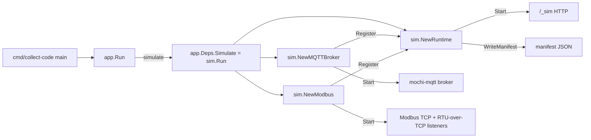
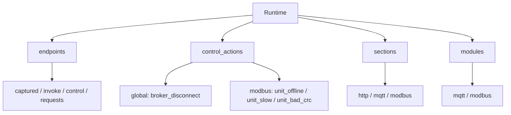
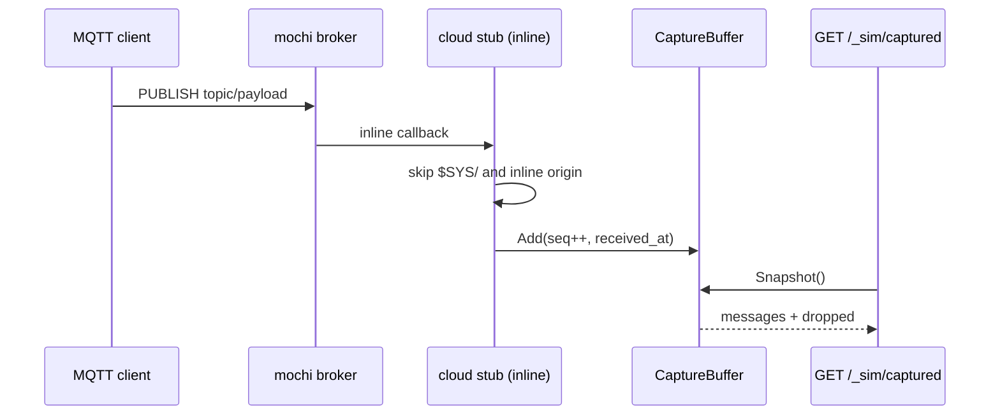
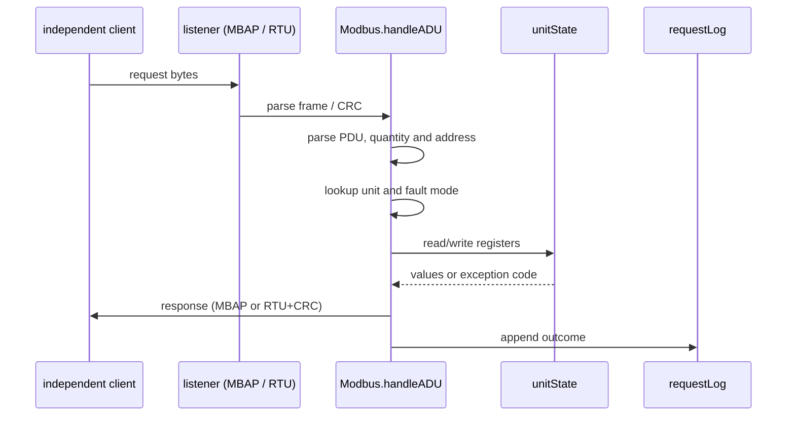
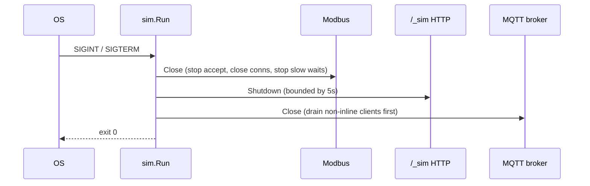
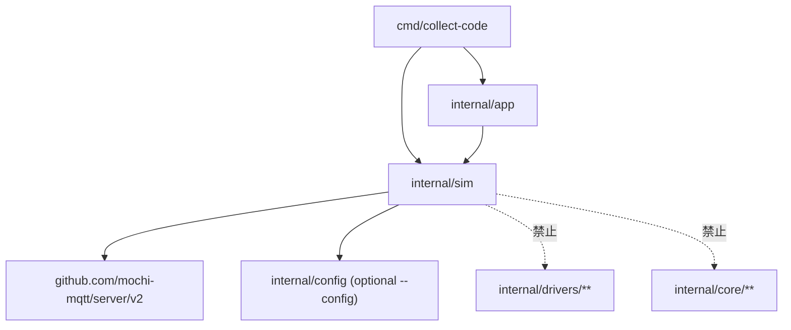
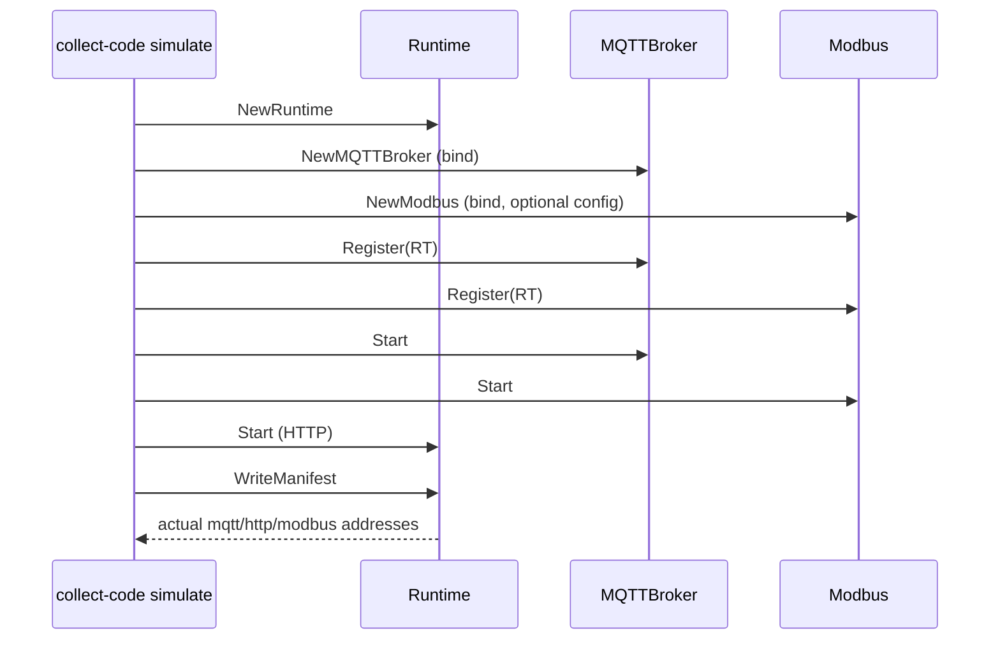
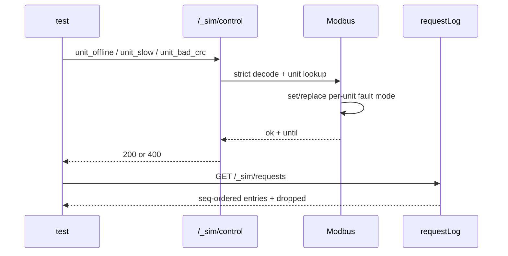

# 06 代码走读：内置模拟器（06a / 06b）

- 状态：完成
- 范围：完整 ticket 06，即 06b 内嵌 MQTT broker 与云端桩、06a Modbus TCP / RTU-over-TCP 从站
- 代码路径：`cmd/collect-code`、`internal/app`、`internal/sim`、`scripts/check-deps.sh`
- 本文只描述已实现的代码。ChirpStack 桩（12a/12b）、生产 Modbus 驱动与真实串口、07 端到端不在本文范围。

模拟器是**测试对端**，不是被测实现的一部分。它和真实二进制跑在同一个进程模型里：
一个 `collect-code simulate` 进程提供 `/_sim/*` HTTP、内嵌 MQTT broker/云端桩、
Modbus TCP 与 RTU-over-TCP 两个从站；所有实际监听端口由内核分配后写进 manifest。

---

## 1. 链路

### 1.1 进程装配

`cmd/collect-code/main.go` 只构造 `app.Deps{Clock, Simulate}` 并交给 `app.Run`。
`simulate` 子命令经注入的 `sim.Run` 进入模拟器；`app` 不 import `internal/sim`。

启动顺序固定：

1. `NewRuntime` 创建 HTTP mux、manifest 注册表、control 注册表与捕获缓冲；
2. `NewMQTTBroker` 绑定 MQTT listener；
3. `NewModbus` 绑定 Modbus TCP 与 RTU-over-TCP listener（可选加载 `--config`）；
4. 两个模块分别 `Register(runtime)`：写 section、endpoint、route 与 control action；
5. `broker.Start()`、`modbus.Start()`、`runtime.Start()`；
6. `runtime.WriteManifest(path)` 原子写出实际地址；
7. 等信号或上下文取消，按 Modbus → HTTP → MQTT 的顺序关闭。

`--config` 只在构造 Modbus 时读取四层配置；MQTT/HTTP 的既有 flag 语义不变。
配置加载失败发生在绑定端口之前，返回启动错误（退出码 1）。

### 1.2 manifest 与 /_sim 端点

`Runtime` 是共享注册面：模块在 `Start` 前调用 `SetSection`、`SetEndpoint`、`Handle`
与 `RegisterControl`。manifest 是这些注册结果的快照：

manifest 是加法扩展：新增 `modbus` section、`requests` endpoint 或 `modbus` actions
不提升 `schema_version`；消费者按字段名读取并忽略未知字段。

### 1.3 MQTT 捕获与注入

云端桩是 mochi 的 inline 客户端。真实客户端 publish 后，inline 回调把消息写入有界
环形缓冲；`/_sim/captured` 只读快照。捕获跳过 `$SYS/` 与由 `/_sim/invoke` 产生的
inline-origin 消息，所以它只表示“收到的上行”。

`/_sim/invoke` 走 inline `Publish`，不进入捕获；`broker_disconnect` 踢掉非 inline
连接，并通过 auth hook 的 `hold_until` 惰性拒绝保持期内的新 CONNECT。

### 1.4 Modbus 请求链路

Modbus 模块在 `internal/sim` 内独立实现 MBAP、RTU ADU、CRC-16/MODBUS 与 PDU 校验，
不 import `internal/drivers/modbus`。两个 listener 共享同一份 unit 表、故障状态和请求日志。

关键分支：

- **未知 unit**：不响应，记 `no_response`，连接保持；
- **unit_offline**：不响应，记 `no_response`；
- **unit_slow**：正常处理，延迟后写响应，`duration_ms` 记录实际等待；
- **unit_bad_crc**：RTU 响应故意写错 CRC，记 `bad_crc`；Modbus TCP 无 CRC，仍回合法响应；
- **请求 CRC 错**：RTU 不响应、连接保持、记 `bad_frame`；
- **RTU 未知功能码**：帧边界不可信，关闭连接、记 `bad_frame`；
- **MBAP 头部非法/截断**：关闭连接、记 `bad_frame`。

故障模式是 per-unit 的，重复控制覆盖旧模式；`duration_ms > 0` 的到期判定在每次请求时
用注入时钟惰性完成，没有后台 timer。

### 1.5 关闭链路

06b 的 hotfix 在关闭 broker 前先 drain 真实客户端，避免 mochi 的
`GetByListener` 与客户端删除并发死锁；06a 的 `Close` 先关闭 listener 与活动连接，
并通过 `done` 通道打断 `unit_slow` 的等待，保证进程不会因故障注入而挂住。

---

## 2. 组件与对象关系

### 2.1 包依赖

`scripts/check-deps.sh` 同时检查生产闭包与测试闭包：`internal/sim` 及其 `_test.go`
都不得出现 `internal/drivers` 或 `internal/core`。这保证模拟器的 Modbus 实现和独立
测试客户端不会偷用被测驱动。

### 2.2 文件职责

| 文件 | 职责 |
|---|---|
| `internal/sim/runtime.go` | `/_sim` HTTP、route/endpoint/section/control 注册、manifest 生命周期 |
| `internal/sim/http.go` | JSON 响应、严格解码、1 MiB body、captured/control handler |
| `internal/sim/manifest.go` | `schema_version=1`、保留 section、同目录 temp+fsync+rename |
| `internal/sim/capture.go` | MQTT 上行有界环形缓冲、`seq`/`dropped`、payload JSON 表示 |
| `internal/sim/mqtt.go` | mochi 装配、单 auth hook、inline 捕获/注入、broker_disconnect |
| `internal/sim/modbus.go` | 两个 listener、连接生命周期、请求分派、响应写回 |
| `internal/sim/modbus_frame.go` | MBAP / RTU ADU、CRC-16/MODBUS、帧错误分类 |
| `internal/sim/modbus_pdu.go` | 03/04/06/16 请求校验与响应编码、异常码 |
| `internal/sim/modbus_registers.go` | ASSUMED 寄存器表、unit 状态、读写语义 |
| `internal/sim/modbus_config.go` | `--config` 派生 unit/寄存器；宽度/访问冲突启动错误 |
| `internal/sim/modbus_requests.go` | `/_sim/requests`、10000 条环形日志 |
| `internal/sim/modbus_control.go` | per-unit offline/slow/bad_crc、惰性恢复 |
| `internal/sim/run.go` | `simulate` flags、信号、启动/关闭顺序、退出码 |
| `internal/sim/modbusclient_test.go` | 独立 Modbus 客户端（自带 MBAP/RTU/CRC，不 import 驱动） |

### 2.3 寄存器模型

`unitState` 以 `(input, address)` 为键保存原始 uint16 值。内置表来自
`docs/缺口台账.md` 的 `ASSUMED` 寄存器表与模拟初值；`--config` 在保留内置初值的前提
下叠加 profile 声明的读写访问。缩放不在这里做：模拟器只提供原始寄存器，缩放由引擎负责。

写语义：

- 写保持 `0x0002`（目标开度）→ `target = current = value`，状态字置 0；
- 写保持 `0x0003`（阀门指令）→ `1` 全开、`2` 全关、`0` 不变；
- 写多寄存器原子校验，任一地址不可写则整帧拒绝；
- 只读/未实现地址返回异常 `02`，数量越界返回异常 `03`，未知功能码返回异常 `01`。

---

## 3. 时序与状态

### 3.1 启动与 manifest

### 3.2 请求日志与故障控制

`/_sim/requests` 与 `/_sim/control` 都走同一个 Runtime HTTP 服务：

请求日志固定 10000 条：满时丢最旧并累加 `dropped`；空时返回 `[]`。条目按到达顺序，
`seq` 从 1 单调递增；`received_at`/`responded_at` 用注入时钟，`duration_ms` 记录实际等待。

---

## 4. 关键不变量

1. **独立实现**：模拟器的 MBAP/RTU/CRC/PDU 与测试客户端都不 import 被测驱动；
   `scripts/check-deps.sh` 检查生产闭包与测试闭包。
2. **加法 manifest**：`modbus` section、`requests` endpoint 与 `modbus` actions 都是
   加法扩展，`schema_version` 保持 1；06b 的消费者不需要改。
3. **有界内存**：MQTT 捕获与 Modbus 请求日志都是固定容量环形缓冲，满时丢最旧并计数。
4. **惰性恢复**：per-unit 故障模式只在请求到达时用注入时钟判断到期，不启动后台 timer。
5. **自包含**：不依赖 docker、apt、mosquitto 或外部服务；两个 Modbus listener 默认只绑
   loopback，显式非 loopback 只告警。
6. **可关闭**：`Close` 关闭 listener、活动连接与 slow 等待，SIGTERM 后退出码 0 且端口释放。

---

## 5. 测试证据

| 验收面 | 测试 / 检查 |
|---|---|
| TCP / RTU-over-TCP 双从站、多 unit | `TestModbusBuiltinReadsTCP`、`TestModbusRTUOverTCP` |
| 独立实现站号/功能码/地址/数量/CRC/异常码 | `TestModbusExceptions`、`TestModbusCRC16KnownVector`、`TestModbusReadRTU*`、`TestModbusParseRequestBounds` |
| 独立客户端断言请求日志 | `modbusclient_test.go`、`TestModbusRequestsEndpoint`、`TestModbusControlOfflineAndRecovery` |
| per-unit offline/slow/bad_crc | `TestModbusControlOfflineAndRecovery`、`TestModbusControlSlow`、`TestModbusControlBadCRC`、`TestModbusControlValidation` |
| `--config` 同一 profile | `TestModbusConfigProfile`、`TestModbusConfigAccessConflict` |
| 进程级装配与关闭 | `TestSimulateProcessModbus`、`TestSimulateProcessSignals` |
| 依赖边界 | `scripts/check-deps.sh`（生产闭包 + `go list -deps -test`） |
| 静态构建 | `make check`：linux/amd64 + linux/arm64，`CGO_ENABLED=0` |

---

## 6. 不含

- ChirpStack gRPC 桩与 MQTT integration fixture（12a/12b）；
- 生产 Modbus 驱动、真实串口 RTU、termios/波特率；
- 07 端到端 smoke、09 服务调用与写后回读；
- 生产 MQTT 北向通道（05a）与物模型适配器（05b）。
